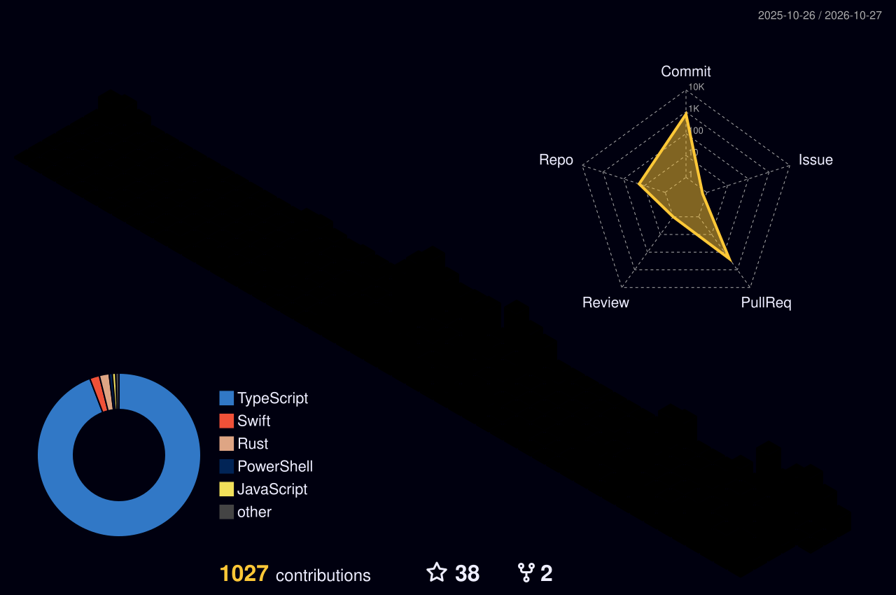

<h1 align="center"> :boar: Hi, I'm MidSeeLee :boar:</h1>
 
<!--START_SECTION:waka-->


**🐱 My GitHub Data** 

> 📦 167.7 kB Used in GitHub's Storage 
 > 
> 🏆 927 Contributions in the Year 2026
 > 
> 💼 Opted to Hire
 > 
> 📜 153 Public Repositories 
 > 
> 🔑 11 Private Repositories 
 > 
**I'm an Early 🐤** 

```text
🌞 Morning                24386 commits       ████████░░░░░░░░░░░░░░░░░   32.04 % 
🌆 Daytime                17410 commits       ██████░░░░░░░░░░░░░░░░░░░   22.88 % 
🌃 Evening                32407 commits       ███████████░░░░░░░░░░░░░░   42.58 % 
🌙 Night                  1900 commits        █░░░░░░░░░░░░░░░░░░░░░░░░   02.50 % 
```
📅 **I'm Most Productive on Saturday** 

```text
Monday                   10601 commits       ███░░░░░░░░░░░░░░░░░░░░░░   13.93 % 
Tuesday                  9132 commits        ███░░░░░░░░░░░░░░░░░░░░░░   12.00 % 
Wednesday                7604 commits        ██░░░░░░░░░░░░░░░░░░░░░░░   09.99 % 
Thursday                 6439 commits        ██░░░░░░░░░░░░░░░░░░░░░░░   08.46 % 
Friday                   6804 commits        ██░░░░░░░░░░░░░░░░░░░░░░░   08.94 % 
Saturday                 19023 commits       ██████░░░░░░░░░░░░░░░░░░░   25.00 % 
Sunday                   16500 commits       █████░░░░░░░░░░░░░░░░░░░░   21.68 % 
```


📊 **This Week I Spent My Time On** 

```text
🕑︎ Time Zone: Asia/Bangkok

💬 Programming Languages: 
TypeScript               18 hrs 1 min        █████████████░░░░░░░░░░░░   50.36 % 
Other                    7 hrs 41 mins       █████░░░░░░░░░░░░░░░░░░░░   21.50 % 
Markdown                 6 hrs 22 mins       ████░░░░░░░░░░░░░░░░░░░░░   17.84 % 
JSON                     1 hr 33 mins        █░░░░░░░░░░░░░░░░░░░░░░░░   04.36 % 
TSV                      33 mins             ░░░░░░░░░░░░░░░░░░░░░░░░░   01.57 % 

🔥 Editors: 
Zed                      16 hrs 9 mins       ███████████░░░░░░░░░░░░░░   45.18 % 
Bot                      5 hrs 9 mins        ████░░░░░░░░░░░░░░░░░░░░░   14.40 % 
Codex Vscode             4 hrs 11 mins       ███░░░░░░░░░░░░░░░░░░░░░░   11.74 % 
Agent                    3 hrs 45 mins       ███░░░░░░░░░░░░░░░░░░░░░░   10.50 % 
ZCode                    3 hrs 9 mins        ██░░░░░░░░░░░░░░░░░░░░░░░   08.80 % 

💻 Operating System: 
Mac                      35 hrs 46 mins      █████████████████████████   100.00 % 
```

🤖 **AI Coding This Week** 

```text
⏱ AI Coding Time: 31 hrs 25 mins (87.82%)

✍️ 11,230 lines written by AI, 1,104 lines written by hand (91.05% AI-written)

🔤 15,796,801 Input Tokens, 2,975,902 Output Tokens

💵 $444.93 Estimated AI Cost This Week

🧠 115 AI Sessions, 378 AI Prompts

GPT                      5,853 lines         ████████████░░░░░░░░░░░░░   49.96 % 
GLM                      5,100 lines         ███████████░░░░░░░░░░░░░░   43.53 % 
ZCode                    668 lines           █░░░░░░░░░░░░░░░░░░░░░░░░   05.70 % 
Sonnet                   95 lines            ░░░░░░░░░░░░░░░░░░░░░░░░░   00.81 % 
Codex-Vscode             0 lines             ░░░░░░░░░░░░░░░░░░░░░░░░░   00.00 % 

🔎 AI Coding Insights:
🤖 AI-Driven — 91.05% of written lines came from AI
📄 Detailed Prompter — average 1,254 characters per prompt
🔁 Iterative Prompter — average 3 prompts per session
🚀 High AI Trust — 9.81% of changed lines were hand-edited
```


 Last Updated on 19/10/2026 21:35:21 UTC
<!--END_SECTION:waka-->

##



## Familiar with:
- JavaScript / TypeScript
- Flutter / Dart

## In domains of:
- Frontend Web
  - React / Next.js
  - Angular
- Backend Web
  - Node: Express / Nest.js / Meteor
  - Python: Flask
  - JAVA : Spring Boot
- Mobile
  - Cross Platform: Flutter
- Database
  - SQL: MySQL/ MariaDb / Postgres
  - NoSQL: MongoDB
  - ORM: Prisma / Mongoose
